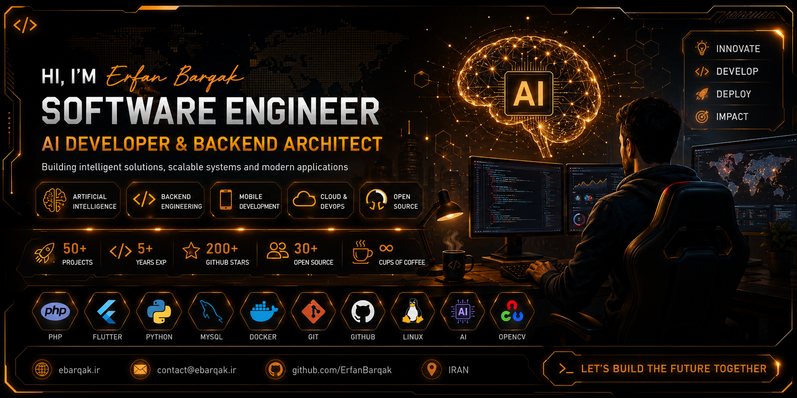

<!-- ====================================================== -->
<!--                    HERO SECTION                        -->
<!-- ====================================================== -->

<div align="center">



</div>

<br>

<h1 align="center">

Hi 👋 I'm <span style="color:#F5A623;">Erfan Barqak</span>

</h1>

<h3 align="center">

Developer • AI Engineer • System Architect

</h3>

<p align="center">

Building Intelligent Software with Modern Technologies

</p>

---

<div align="center">

[](https://ebarqak.ir)

[](https://github.com/erfanbarghak)

[](mailto:you@example.com)

</div>

---

<div align="center">


</div>

---

## 🚀 About Me

```text
💡 Passionate about solving real-world problems with software.

🧠 Artificial Intelligence & Computer Vision Developer.

⚙️ Backend Architect using PHP & CodeIgniter.

📱 Flutter Cross Platform Developer.

☁️ Cloud, Docker & Linux Enthusiast.

❤️ Open Source Contributor.

🚀 Building scalable intelligent systems.
```
